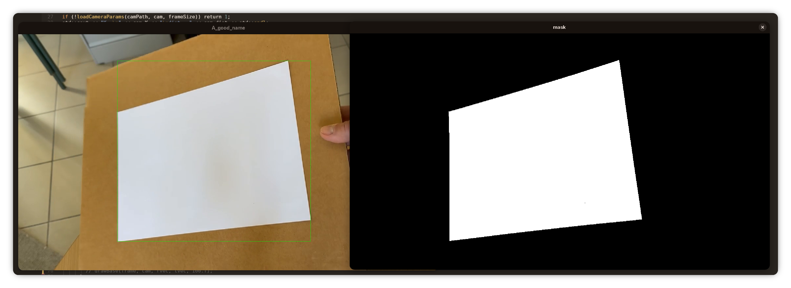
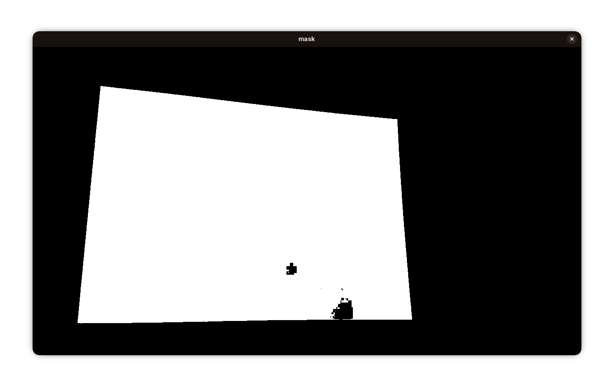
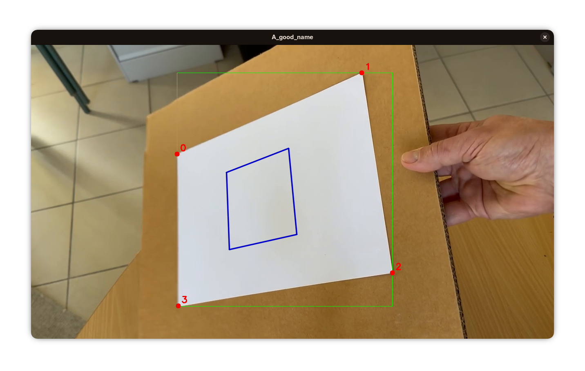
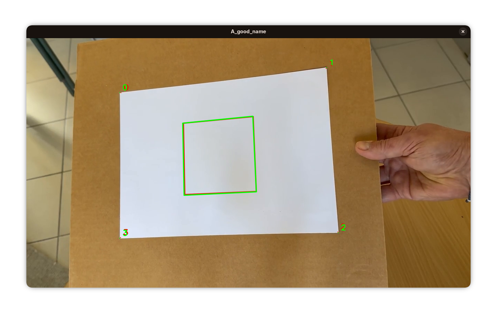

# Installation

```bash
# Créer le dossier de build
mkdir build && cd build

# Configurer avec CMake
cmake ..

# Compiler
make
```

# Utilisation

```bash
./CoursOpenCv [video] [camera.yaml]
```

Par défaut : `../b.mp4` et `../input_camera.yaml`. `q` ou `Échap` pour quitter, `Espace` pour mettre en pause.

# Journal

## 1. Trouver la feuille (`findPaperSheet`)

On passe l'image en noir et blanc, puis on garde seulement les zones très claires (seuil à 180). MSER repère les grandes zones claires (entre 40 000 et 500 000 pixels) et on prend la plus grosse. Le rectangle vert, c'est la boîte autour de cette zone. Ce qu'il y a dans la boîte est affiché dans la fenêtre `mask`.



Le masque n'est pas toujours propre : ici il a des trous à cause de l'ombre.



## 2. Trouver les 4 coins (`main.cpp`, `orderCorners`)

On prend le plus grand contour du masque et on le simplifie (`approxPolyDP`) jusqu'à n'avoir que 4 points. Ensuite on numérote les coins de 0 à 3 : le 0 est en haut à gauche, et le côté 0→1 est un grand côté de la feuille.


## 3. Calculer la position de la feuille (`estimatePose`)

On dit à OpenCV que ces 4 coins sont ceux d'une feuille A4 (297 × 210 mm). `solvePnP` calcule alors où est la feuille et comment elle est tournée par rapport à la caméra. Il utilise les réglages de la caméra du fichier `input_camera.yaml`. Pour vérifier que c'est bon, `drawBase` dessine un carré de 100 mm (en bleu) posé sur la feuille.




## 4. Passage de MSER à la croissance de région

Lors des tests, MSER s'est révélé un peu lent, donc nous sommes passés à une croissance de région. C'est moins précis que MSER, mais environ 4x plus rapide : 40 ms pour MSER contre 10 ms pour la croissance de région (RG).  
En vert : MSER, en rouge : RG.


# Chantiers actuels

- Tester la robustesse : calibrer une nouvelle caméra et tester une nouvelle vidéo.
- Persistance temporelle : essayer de prédire la prochaine position des points.
- Architecture : bien ranger le code et préparer l'extension du projet vers OpenGL.
